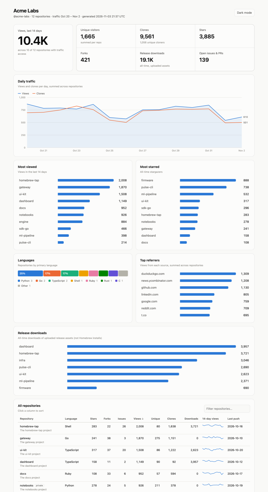
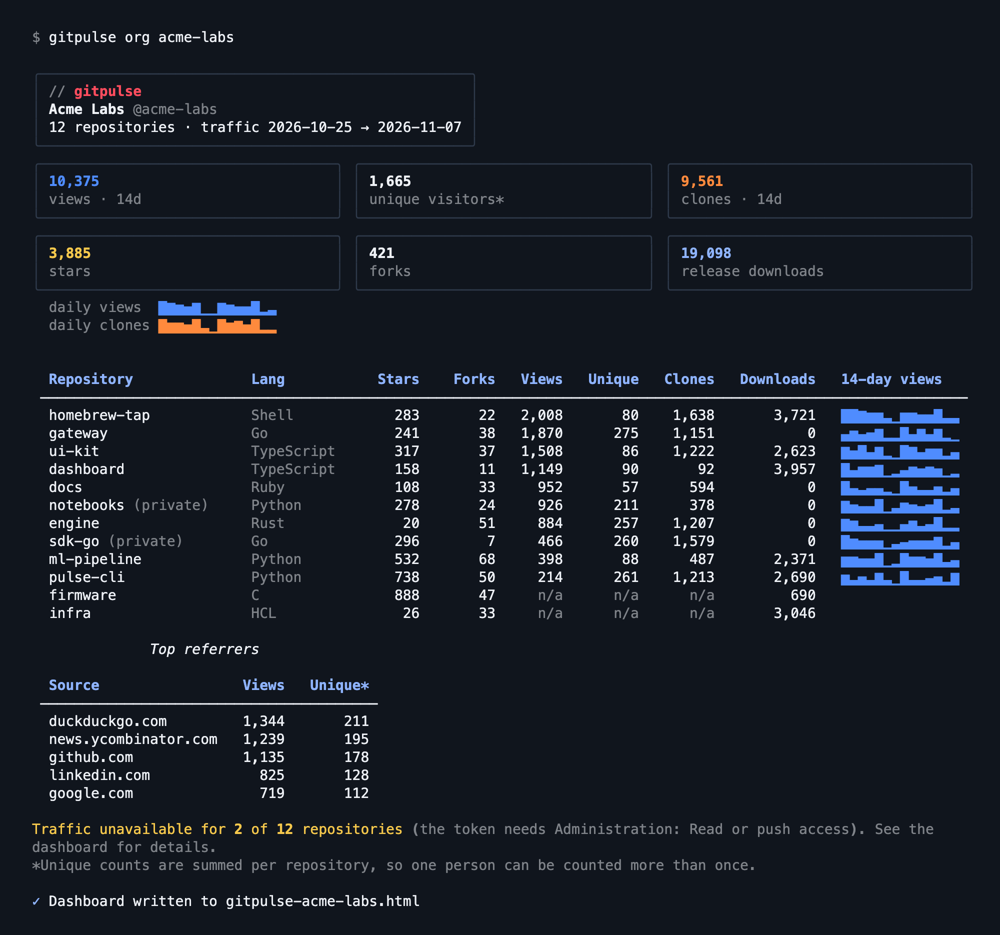
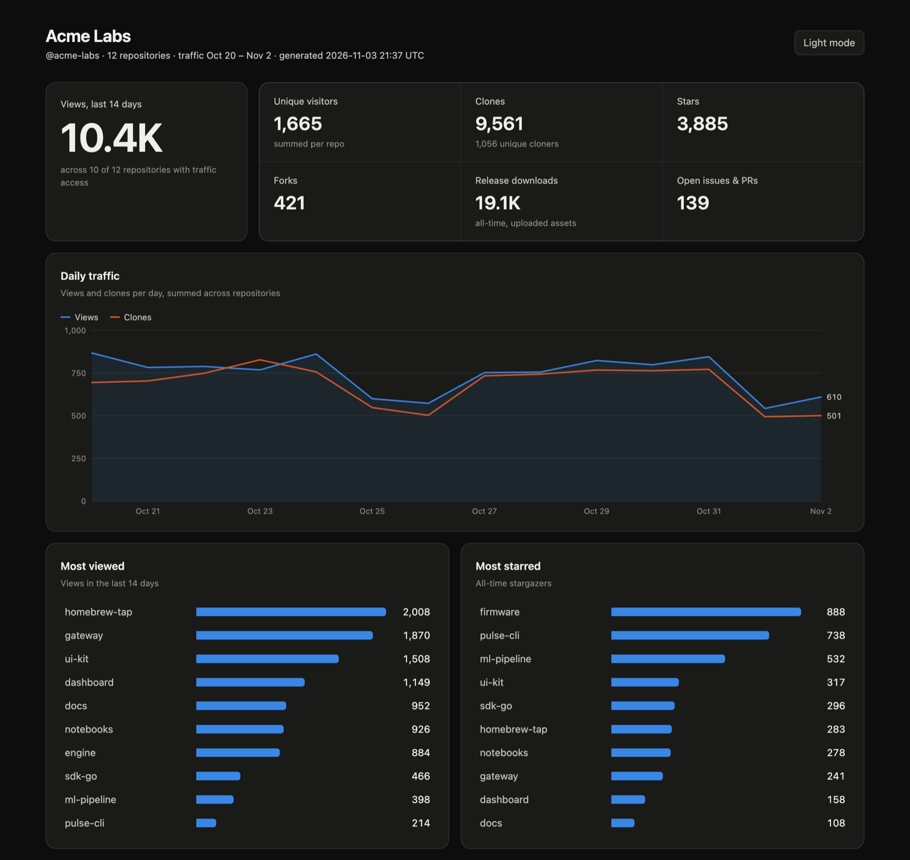

# GitPulse

[](https://github.com/fullstackspectrum/gitpulse/actions/workflows/ci.yml)
[](https://pypi.org/project/gitpulse-analytics/)
[](https://pypi.org/project/gitpulse-analytics/)
[](https://github.com/fullstackspectrum/homebrew-gitpulse)
[](https://hub.docker.com/r/fullstackspectrum/gitpulse)
[](LICENSE)
<br>
[](https://pepy.tech/projects/gitpulse-analytics)
[](https://hub.docker.com/r/fullstackspectrum/gitpulse)

A local Python CLI for GitHub repository traffic and release asset download stats. GitPulse can build a dashboard for a whole organization, and it keeps SQLite snapshots so you have history beyond GitHub's short traffic window.

> **What GitHub can tell you:** aggregate daily views and clones, unique counts, popular paths, referrers, and release-asset download totals. It does **not** identify individual visitors or people who cloned a repository. GitHub's traffic data is generally available for the most recent 14 days. Release asset downloads are not Homebrew formula install counts.



## Requirements

- Python 3.10+
- A GitHub token with access to the repositories you want to inspect. Classic tokens need the `repo` scope for private repositories. For fine-grained tokens, grant these repository permissions:

  | Permission | Needed for |
  | --- | --- |
  | **Metadata: read** | All commands (always included) |
  | **Contents: read** | `downloads`, and release downloads in `org` |
  | **Administration: read** | `traffic`, `snapshot`, and traffic in `org` |

  A fine-grained token only covers repositories owned by its resource owner, so org-owned repositories need a token whose resource owner is that org. Without a required permission, GitHub returns `Resource not accessible by personal access token`.

Traffic endpoints only work for repositories you have push access to. Public visibility alone does not grant access to traffic analytics.

## Install

**Homebrew** (macOS and Linux):

```sh
brew install fullstackspectrum/gitpulse/gitpulse
```

**pipx or pip.** The package is called `gitpulse-analytics` on PyPI; the command it installs is `gitpulse`:

```sh
pipx install gitpulse-analytics
# or
python -m pip install gitpulse-analytics
```

**Docker.** Images for `linux/amd64` and `linux/arm64` are on [Docker Hub](https://hub.docker.com/r/fullstackspectrum/gitpulse). Mount a directory at `/data` to keep the HTML dashboard and snapshot history:

```sh
docker run --rm -e GITHUB_TOKEN -v "$PWD:/data" fullstackspectrum/gitpulse org ORG
```

The image is built on a [Docker Hardened Image](https://dhi.io) (Alpine), so it has no shell or package manager and runs as the non-root UID 65532. On Linux, if that UID can't write the mounted directory, add `--user "$(id -u):$(id -g)"`.

**From source**, for development:

```sh
python3 -m venv .venv
source .venv/bin/activate
python -m pip install --upgrade pip
python -m pip install -e '.[dev]'
```

Check the install with `gitpulse --version`.

Set a token in your shell. `GITHUB_TOKEN` and `GH_TOKEN` are both supported. GitPulse never saves the token:

```sh
export GITHUB_TOKEN="github_pat_..."
```

If you use the [GitHub CLI](https://cli.github.com/) and are signed in with `gh auth login`, you can reuse its token instead:

```sh
export GITHUB_TOKEN="$(gh auth token)"
```

## Organization dashboard

```sh
gitpulse org ORG                                   # terminal summary + gitpulse-ORG.html
gitpulse org ORG --open                            # also open the dashboard in your browser
gitpulse org ORG --save                            # also save views/clones snapshots for `history`
gitpulse org ORG --all --output reports/org.html   # include forks and archived repos, custom path
```

`org` works for an organization or a user account. It fetches every repository in parallel (`--workers`, default 8), then prints a summary in the terminal: totals, daily sparklines, a table of every repository, and the top referrers.



It also writes a self-contained HTML dashboard to `gitpulse-ORG.html` in the current directory, or to the path you pass with `--output`. The dashboard shows:

- Totals for views, unique visitors, clones, stars, forks, release downloads, and open issues and PRs
- Daily views and clones summed across repositories, with a hover readout for each day
- The most viewed and most starred repositories, a language breakdown, top referrers, and release downloads by repository
- A sortable, filterable table of every repository with a 14-day views sparkline

Styles, charts, and scripts are all inline, so it works offline (only the owner's avatar loads from GitHub). It follows your system's light or dark theme, and has a toggle to switch.



By default, forks and archived repositories are skipped; `--all` includes them. When your token can't read traffic for a repository, its stars, forks, and downloads still appear, and the dashboard lists which repositories are missing traffic and why. Unique visitor and cloner counts are summed per repository, so one person who visits two repositories is counted twice.

*Screenshots show sample data.*

## Repository commands

```sh
gitpulse --help
gitpulse repos
gitpulse repos --all
gitpulse traffic OWNER/REPO
gitpulse traffic OWNER/REPO --metric clones
gitpulse traffic OWNER/REPO --metric referrers
gitpulse traffic OWNER/REPO --metric popular/paths
gitpulse traffic OWNER/REPO --metric views --save
gitpulse snapshot OWNER/REPO
gitpulse history OWNER/REPO --metric views
gitpulse history OWNER/REPO --metric clones
gitpulse downloads OWNER/REPO
```

`repos` lists repositories accessible to the authenticated account and filters forks and archived repositories by default. `--all` includes them.

`traffic` displays GitHub's recent traffic response. `snapshot` fetches views and clones and saves both responses locally. Run it on a schedule (for example, daily) to build a history beyond GitHub's 14-day window. `history` displays saved snapshots; it does not backfill earlier data.

`downloads` lists release asset download counts. It does not measure Homebrew formula installation.

## Local data and privacy

Snapshots are stored at `~/.local/share/gitpulse/gitpulse.sqlite3`. The database contains repository names and traffic responses, but no GitHub token. To use another location, set `GITPULSE_DB` to a SQLite file path.

Generated dashboards contain repository names, descriptions, and traffic numbers, including for private repositories. Treat them like any other internal report before sharing. `gitpulse-*.html` files are ignored by git.

## Homebrew tap usage

For tap repositories, clone traffic and unique cloners can be useful directional signals, but they are not install totals. A tap clone, formula installation, and binary download are distinct events. GitHub does not expose an install-by-user report for formulae through these traffic endpoints.

## Development

Run tests with `pytest` and lint with `ruff check .`.

### Releasing

1. Bump `__version__` in `src/gitpulse/__init__.py`.
2. In [CHANGELOG.md](CHANGELOG.md), move the `Unreleased` entries under a new `X.Y.Z` heading with the date, and update the comparison links at the bottom. Merge to `main`.
3. Publish a GitHub release with the tag `vX.Y.Z` matching that version, using that version's changelog section as the release notes.

The `Release` workflow checks that the tag matches the version, then publishes to PyPI. After that it pushes the multi-arch Docker image and updates the formula in [homebrew-gitpulse](https://github.com/fullstackspectrum/homebrew-gitpulse). A release marked as a pre-release goes to PyPI and to Docker Hub under its exact version tag only, without moving `latest` or the Homebrew formula. The formula template lives in `packaging/homebrew/`; edit it there, not in the tap.
